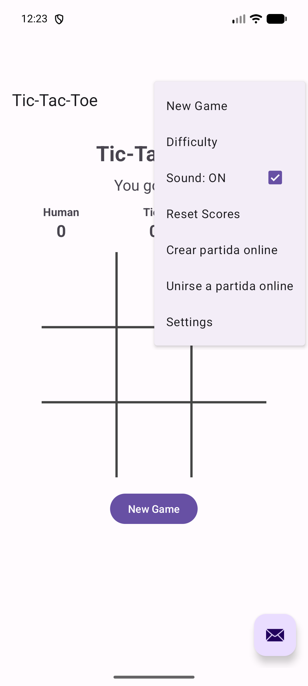
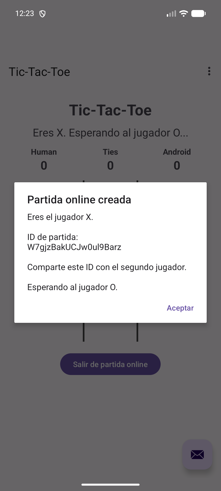
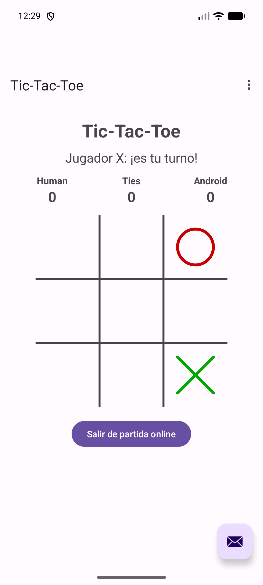
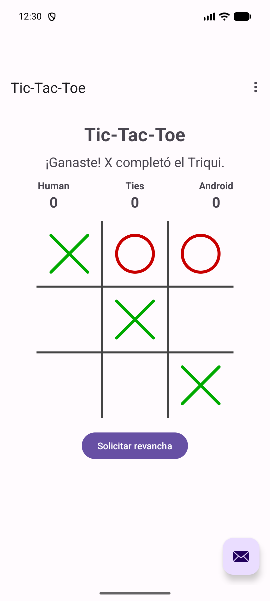
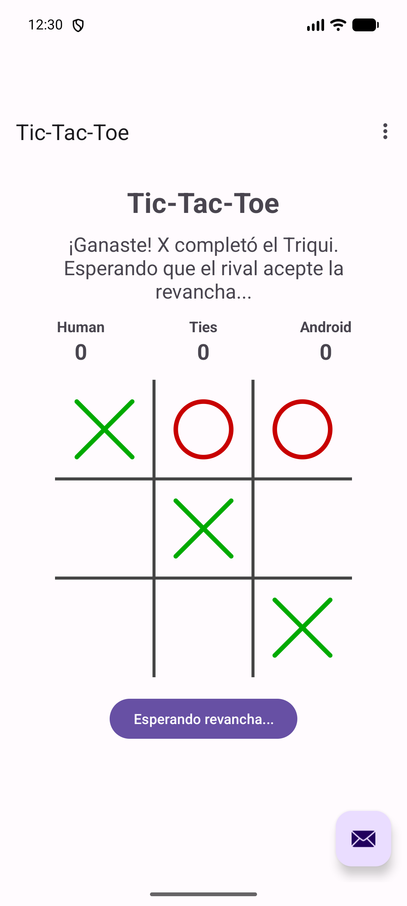
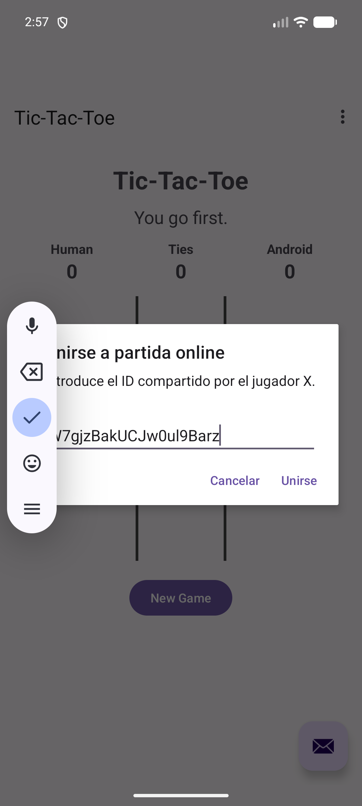

# ❌⭕ Reto 7 – Triqui Online con Firebase y revancha

> **Curso:** Desarrollo de Aplicaciones para Dispositivos Móviles · Universidad Nacional de Colombia
> **Autor y desarrollador:** Luis Alberto Castillo Sanabria
> **Plataforma:** Android (Kotlin) + Firebase (Authentication y Cloud Firestore)

El Triqui da el salto a **multijugador en línea**. Dos personas, cada una en su teléfono, juegan la misma partida en tiempo real a través de **Cloud Firestore**. Un jugador crea la partida y comparte su ID; el otro se une con ese ID. Al terminar pueden pedir **revancha** sin crear una partida nueva. El modo contra Android de los retos anteriores sigue disponible.

| Menú con modo online | Partida creada | Turno en línea |
|:---:|:---:|:---:|
|  |  |  |

| Victoria en línea | Revancha solicitada | Unirse con un ID |
|:---:|:---:|:---:|
|  |  |  |

## Funcionalidades

- **Crear partida online:** el creador es la **X** y recibe un **ID** para compartir.
- **Unirse a partida online:** el segundo jugador escribe el ID y juega con la **O**.
- **Sincronización en tiempo real** del tablero, el turno y el resultado con *snapshot listeners* de Firestore.
- **Validación en transacciones:** solo juega quien tiene el turno, en casillas libres y en partidas activas.
- **Revancha:** al terminar, un jugador la solicita y el otro la acepta; el tablero se reinicia en ambos teléfonos.
- **Autenticación anónima** con Firebase: no hace falta crear cuenta.
- Se conserva el modo **contra Android** con marcador persistente, sonido, dificultad, Canvas y rotación de los retos 5 y 6.

## Documentación

📘 **[Manual de usuario y técnico](docs/MANUAL.md)**

## Tecnologías

Kotlin · Firebase BoM 34 · Firebase Authentication (anónima) · Cloud Firestore · Canvas · `SharedPreferences` · minSdk 24

## Cómo ejecutarlo

> ⚠️ El archivo `app/google-services.json` **no está en el repositorio** porque contiene la configuración privada del proyecto de Firebase. Para compilar necesitas el tuyo.

1. `git clone https://github.com/LCastillo9806/Reto07-TriquiOnline-Firebase.git`
2. En la [consola de Firebase](https://console.firebase.google.com/) crea un proyecto, agrega una app Android con el paquete `co.edu.unal.tictactoe`, activa **Authentication → Anónimo** y **Cloud Firestore**.
3. Descarga `google-services.json` y cópialo en la carpeta `app/`.
4. Abre el proyecto en **Android Studio** y pulsa **Run ▶** en dos dispositivos o emuladores.

## Autoría

Desarrollado por **Luis Alberto Castillo Sanabria** ([@LCastillo9806](https://github.com/LCastillo9806)) — Universidad Nacional de Colombia.
