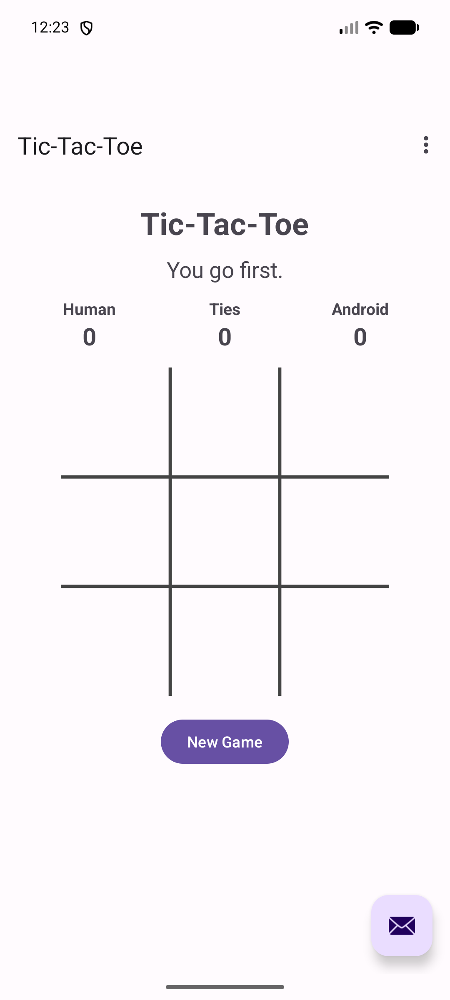
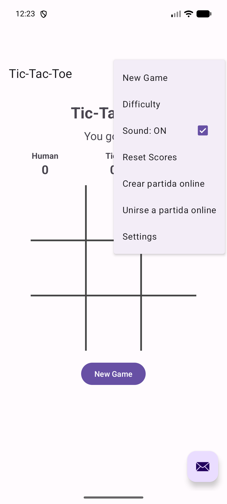
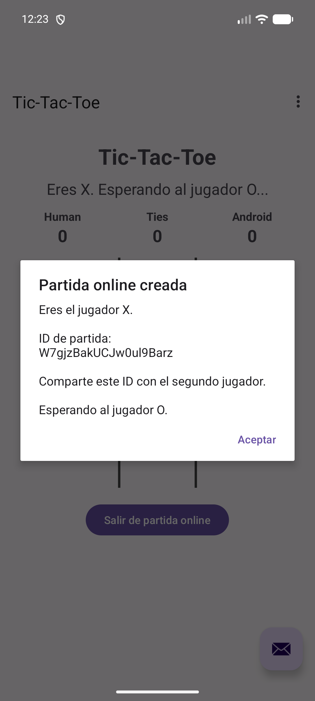
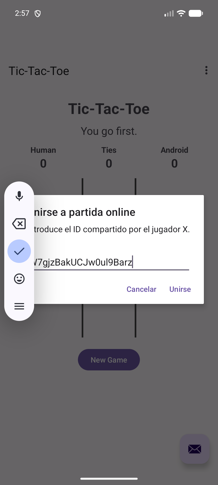
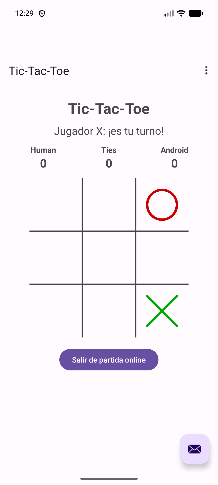
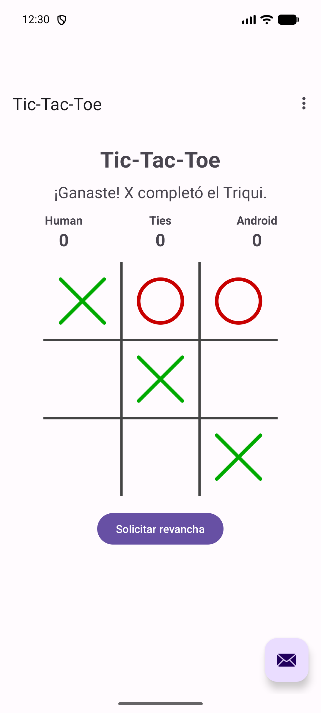
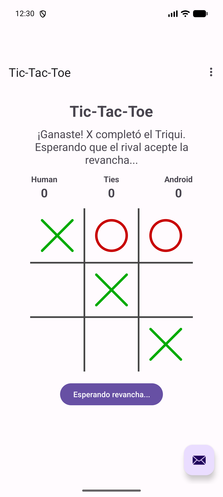

# ❌⭕ Manual de Usuario y Técnico — Reto 7: Triqui Online con Firebase y revancha

> **Curso:** Desarrollo de Aplicaciones para Dispositivos Móviles
> **Autor y desarrollador:** Luis Alberto Castillo Sanabria
> **Institución:** Universidad Nacional de Colombia
> **Plataforma:** Android · Kotlin · Firebase Authentication · Cloud Firestore

---

## 📑 Tabla de contenidos

1. [Propósito](#1-propósito)
2. [Autoría](#2-autoría)
3. [Manual de uso](#3-manual-de-uso)
   - [3.1 Pantalla inicial y menú](#31-pantalla-inicial-y-menú)
   - [3.2 Crear una partida online (jugador X)](#32-crear-una-partida-online-jugador-x)
   - [3.3 Unirse a una partida (jugador O)](#33-unirse-a-una-partida-jugador-o)
   - [3.4 Jugar en línea](#34-jugar-en-línea)
   - [3.5 Revancha](#35-revancha)
   - [3.6 Salir de la partida online](#36-salir-de-la-partida-online)
4. [Modelo de datos en Firestore](#4-modelo-de-datos-en-firestore)
5. [Sincronización y reglas del juego en línea](#5-sincronización-y-reglas-del-juego-en-línea)
6. [Arquitectura y código](#6-arquitectura-y-código)
7. [Configuración de Firebase y compilación](#7-configuración-de-firebase-y-compilación)

---

## 1. Propósito

Convertir el Triqui en un juego **multijugador en tiempo real** entre dos teléfonos, usando servicios en la nube de **Firebase**:

- **Authentication (anónima):** identifica a cada jugador con un ID único sin pedir registro.
- **Cloud Firestore:** guarda cada partida como un documento que ambos teléfonos escuchan y actualizan.

## 2. Autoría

| Integrante | Rol |
|:---|:---|
| **Luis Alberto Castillo Sanabria** | Autor y desarrollador |

Curso *Desarrollo de Aplicaciones para Dispositivos Móviles* — **Universidad Nacional de Colombia**.
Repositorio: <https://github.com/LCastillo9806/Reto07-TriquiOnline-Firebase>

## 3. Manual de uso

### 3.1 Pantalla inicial y menú

La app abre en el modo **contra Android**, igual que en el Reto 6 (marcador, sonido, dificultad). En el menú **⋮** aparecen dos opciones nuevas:

- **Crear partida online**
- **Unirse a partida online**

| Pantalla inicial | Menú de opciones |
|:---:|:---:|
|  |  |

### 3.2 Crear una partida online (jugador X)

1. Toca **⋮ → Crear partida online**.
2. La app inicia sesión de forma anónima y crea la partida en Firestore.
3. Aparece el diálogo **"Partida online creada"** con el **ID de partida**. Compártelo con tu rival (por chat, en voz alta, etc.).
4. Mientras nadie se une, el estado dice **"Eres X. Esperando al jugador O..."**.

| Partida creada con su ID |
|:---:|
|  |

### 3.3 Unirse a una partida (jugador O)

1. En el otro teléfono, toca **⋮ → Unirse a partida online**.
2. Escribe el **ID** que te compartieron y pulsa **Unirse**.
3. Aparece **"¡Te uniste correctamente! Eres el jugador O"**. El jugador X empieza.

| Diálogo para unirse |
|:---:|
|  |

### 3.4 Jugar en línea

- Cuando es tu turno, el mensaje dice **"Jugador X: ¡es tu turno!"** (o **O**). Toca una casilla libre.
- Cuando le toca al rival, dice **"Esperando el turno del rival..."** y el tablero no acepta jugadas.
- Cada jugada aparece **al instante** en los dos teléfonos.
- Al final se muestra **"¡Ganaste!"**, **"Perdiste"** o **"¡Empate online!"**.

| Tu turno (el rival ya jugó O) | Ganaste en línea |
|:---:|:---:|
|  |  |

### 3.5 Revancha

1. Al terminar, el botón inferior cambia a **Solicitar revancha**.
2. Al pulsarlo, tu pantalla dice **"Esperando que el rival acepte la revancha..."**.
3. El rival ve el diálogo **"Solicitud de revancha"** y puede **Aceptar** o responder **Ahora no**.
4. Si acepta, el tablero se limpia en ambos teléfonos y empieza una nueva ronda con los mismos jugadores e ID.

| Revancha solicitada |
|:---:|
|  |

### 3.6 Salir de la partida online

Mientras juegas en línea, el botón inferior ofrece **Salir de partida online**. Al confirmar, vuelves al juego contra Android; la partida queda guardada en Firestore.

## 4. Modelo de datos en Firestore

Cada partida es un documento de la colección **`games`**; su ID es el que se comparte entre jugadores.

| Campo | Tipo | Significado |
|---|---|---|
| `playerX` | texto | UID anónimo del creador |
| `playerO` | texto | UID del rival (vacío mientras se espera) |
| `board` | lista de 9 enteros | `0` vacía · `1` X · `2` O |
| `turn` | entero | `1` turno de X · `2` turno de O |
| `status` | texto | `waiting` · `playing` · `finished` |
| `winner` | entero | `0` nadie · `1` X · `2` O · `3` empate |
| `rematchRequestedBy` | texto | UID de quien pidió revancha |
| `round` | entero | Número de ronda (aumenta con cada revancha) |

## 5. Sincronización y reglas del juego en línea

- **Tiempo real:** cada teléfono registra un `addSnapshotListener` sobre el documento. Cuando el rival juega, Firestore envía el cambio y la pantalla se actualiza sola.
- **Transacciones:** unirse, jugar y aceptar revancha se hacen con `runTransaction`. Dentro de la transacción se verifica que:
  - la partida exista y esté en el estado correcto;
  - el jugador pertenezca a la partida y sea su turno;
  - la casilla esté libre y el tablero sea válido.

  Así dos jugadas simultáneas nunca se pisan.
- **Ganador:** `checkOnlineWinner()` revisa las 8 líneas posibles después de cada jugada y actualiza `winner` y `status` en la misma transacción.

```kotlin
transaction.update(
    gameRef,
    mapOf(
        "board"  to board,
        "turn"   to nextTurn,
        "winner" to winner,
        "status" to if (winner == 0) "playing" else "finished"
    )
)
```

*(Fragmento de `OnlineGameManager.makeOnlineMove`.)*

## 6. Arquitectura y código

```
FirstFragment (interfaz)
 ├─ Modo contra Android ── TicTacToeGame · BoardView · SharedPreferences
 └─ Modo online
      └─ OnlineGameManager
           ├─ FirebaseAuth.signInAnonymously()
           ├─ createGame() / joinGame()
           ├─ listenGame()          ── snapshot listener
           ├─ makeOnlineMove()      ── transacción
           └─ requestRematch() / acceptRematch() / rejectRematch()
                       │
                       ▼
              Cloud Firestore: games/{gameId}
```

| Archivo | Función |
|---|---|
| `app/src/main/java/co/edu/unal/tictactoe/OnlineGameManager.kt` | Toda la comunicación con Firebase: autenticación, partidas, jugadas y revancha |
| `app/src/main/java/co/edu/unal/tictactoe/FirstFragment.kt` | Interfaz de ambos modos, diálogos y mensajes de estado |
| `app/src/main/java/co/edu/unal/tictactoe/BoardView.kt` | Tablero dibujado con Canvas |
| `app/src/main/java/co/edu/unal/tictactoe/TicTacToeGame.kt` | Lógica e IA del modo contra Android |
| `app/build.gradle.kts` | Plugin `google-services` y dependencias de Firebase (BoM, Auth, Firestore) |

## 7. Configuración de Firebase y compilación

El archivo `app/google-services.json` **no se incluye en el repositorio** porque es la configuración privada del proyecto de Firebase. Para compilar:

1. Crea un proyecto en la [consola de Firebase](https://console.firebase.google.com/).
2. Agrega una app **Android** con el paquete `co.edu.unal.tictactoe`.
3. En **Authentication → Método de acceso**, habilita **Anónimo**.
4. Crea una base de datos **Cloud Firestore**.
5. Descarga `google-services.json` y colócalo en `app/`.

```bash
git clone https://github.com/LCastillo9806/Reto07-TriquiOnline-Firebase.git
cd Reto07-TriquiOnline-Firebase
# copiar aquí app/google-services.json
./gradlew installDebug
```

Para probar el modo online necesitas **dos dispositivos o emuladores** con Internet.

---
*Luis Alberto Castillo Sanabria — Universidad Nacional de Colombia*
